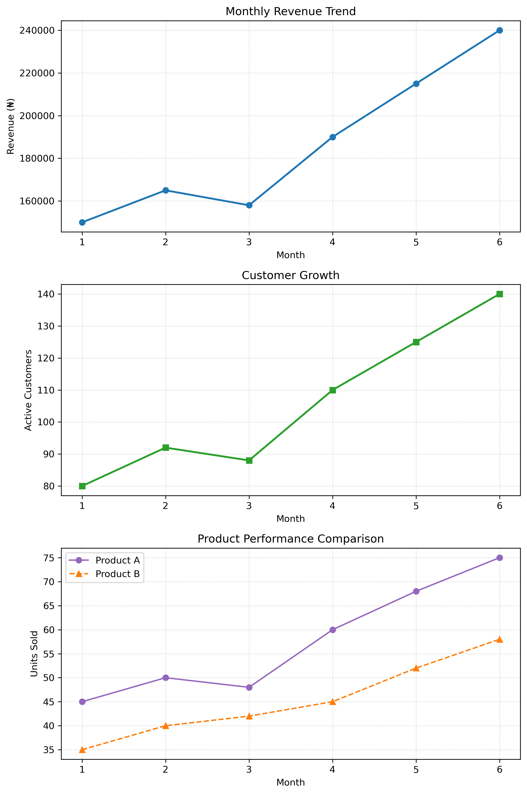

# Python Data Visualization & Business Analytics Portfolio

> A comprehensive collection of Matplotlib data visualization exercises and an applied business analytics dashboard tracking monthly sales, healthcare operations, and company performance.

---

## Table of Contents
- [1. Project Overview](#1-project-overview)
- [2. Hands-On Practice Exercises](#2-hands-on-practice-exercises)
- [3. Mini Project: Business Performance Dashboard](#3-mini-project-business-performance-dashboard)
- [4. Key Business Insights](#4-key-business-insights)
- [5. Tools and Libraries Used](#5-tools-and-libraries-used)
- [6. Instructions for Running the Code](#6-instructions-for-running-the-code)

---

## 1. Project Overview
This repository documents practical work completed within the Third Semester Python study group. It covers foundational data visualization techniques using Matplotlib-ranging from basic line customizations and data annotations to multi-subplot layouts and executive business reporting.

---

## 2. Hands-On Practice Exercises
The notebook builds up core visualization skills through structured exercises:
* **Exercise 1 (Sales Trend & Annotations):** Plotted monthly sales with custom dashed lines and text annotations highlighting specific data points and monetary values in Naira (₦).
* **Exercise 2 (Comparative Acquisition):** Evaluated two separate customer acquisition campaigns using distinct markers, line styles, and color palettes.
* **Exercise 3 (Healthcare Performance Dashboard):** Built a 3-row vertical subplot tracking patient volumes, average wait times, and patient satisfaction scores over time to analyze operational bottlenecks (such as the Month 5 anomaly).

---

## 3. Mini Project: Business Performance Dashboard
The Mini project in the end combines multiple metrics into a single multi-subplot figure using `plt.subplots(3, 1)` to provide the business owner with a clear, unified overview.

### Dataset Description
- **Months:** `[1, 2, 3, 4, 5, 6]`
- **Revenue (₦):** `[150000, 165000, 158000, 190000, 215000, 240000]`
- **Customers:** `[80, 92, 88, 110, 125, 140]`
- **Product A (Units Sold):** `[45, 50, 48, 60, 68, 75]`
- **Product B (Units Sold):** `[35, 40, 42, 45, 52, 58]`

---

## 4. Key Business Insights
* **Consistent Long-Term Growth:** Both revenue and customer acquisition climbed steadily from Month 1 through Month 6.
* **Mid-Period Soft Patch:** Month 3 experienced a synchronized dip across revenue, active customer count, and product sales before rebounding sharply in Month 4.
* **Customer Sync:** Revenue and customer metrics moved in exact tandem every month, showing strong correlation between an expanding user base and financial growth.
* **Product Dominance:** Product A consistently outperformed Product B in unit sales across all six months.

---

## 5. Tools and Libraries Used
* **Python 3**
* **Matplotlib** (for plotting, annotations, and subplot grids)
* **Jupyter Notebook / Google Colab**

---

## 6. Instructions for Running the Code
1. Clone or download this repository.
2. Open [hands_on_practice_19.ipynb](http://localhost:8888/notebooks/Documents%2FPython%20study%20group%2FThird%20Semester%2Fhands_on_practice_19.ipynb) in your Jupyter Notebook environment or Google Colab.
3. Run the cells sequentially to execute both the practice drills and the mini-project visualization code:

```python
import matplotlib.pyplot as plt

months = [1, 2, 3, 4, 5, 6]
revenue = [150000, 165000, 158000, 190000, 215000, 240000]
customers = [80, 92, 88, 110, 125, 140]
product_a = [45, 50, 48, 60, 68, 75]
product_b = [35, 40, 42, 45, 52, 58]

fig, (ax1, ax2, ax3) = plt.subplots(3, 1, figsize=(8, 12))

# 1. Monthly Revenue Trend
ax1.plot(months, revenue, marker="o", color="tab:blue", linewidth=2)
ax1.set_title("Monthly Revenue Trend")
ax1.set_xlabel("Month")
ax1.set_ylabel("Revenue (₦)")
ax1.grid(True, linestyle=":", alpha=0.6)

# 2. Customer Growth
ax2.plot(months, customers, marker="s", color="tab:green", linewidth=2)
ax2.set_title("Customer Growth")
ax2.set_xlabel("Month")
ax2.set_ylabel("Active Customers")
ax2.grid(True, linestyle=":", alpha=0.6)

# 3. Product Performance Comparison
ax3.plot(months, product_a, marker="o", color="tab:purple", label="Product A")
ax3.plot(months, product_b, marker="^", color="tab:orange", linestyle="--", label="Product B")
ax3.set_title("Product Performance Comparison")
ax3.set_xlabel("Month")
ax3.set_ylabel("Units Sold")
ax3.legend()
ax3.grid(True, linestyle=":", alpha=0.6)

fig.tight_layout()
plt.show()



